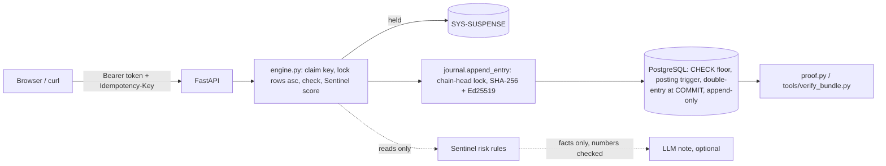

# LedgerLine — money movement with a ledger you can prove

**Live:** `https://<your-service>.onrender.com` ← replace after deploying (docs/DEPLOY.md) · **API docs:** `/docs` · **Demo video:** _link_

LedgerLine moves money between accounts so that:

* **the books always balance**: double entry, with the sum of every balance exactly 0, and no account below its floor. Enforced by PostgreSQL itself, not only by Python.
* **the same request never pays twice**: an Idempotency-Key is claimed in the same transaction as the money movement. Duplicates, even 20 at the same instant, get the first answer byte for byte, and every duplicate is logged.
* **you can prove what happened**: an append-only, hash-chained, **Ed25519-signed** journal of every posting, every refused attempt, every AI suggestion and every human decision. Anyone can verify an export offline with only the public key.

What sets it apart:

* **The database is the backstop.** CHECK constraints and triggers mean even a buggy app cannot overdraw, create money or edit history.
* **Mutation-tested tests.** `tools/mutation_check.py` removes each of 76 locks and checks; the test suite fails every time ([report](docs/MUTATION_REPORT.md)).
* **Red-team script.** `tools/attack.py` runs the judges' attacks (17 of them) against any URL and prints a scorecard.
* **Who did what is on the record too.** New administrators, removed access, auditor approvals, checks of personal details and password changes are signed journal entries, and PostgreSQL refuses any of those changes that is not. Personal data itself never enters the permanent record.
* **AI that flags, people who decide.** Sentinel holds risky payments in suspense with explained reasons. An optional LLM writes reviewer notes that never see user text and whose every number is checked. A test proves the AI cannot reach money-moving code.
* **Race Lab** in the UI fires real concurrent requests from your browser.

## Demo accounts

| Role | Username | Password | Can |
|---|---|---|---|
| Account holder | `priya` | `LedgerPriya#2026` | own accounts LL-1001 (Salary), LL-1002 (Savings): withdraw, transfer, Race Lab. Personal details verified |
| Account holder | `rahul` | `LedgerRahul#2026` | LL-1003, the victim for "move another user's money". Personal details waiting for an administrator to check |
| Account holder | `acme` | `LedgerAcme#2026` | LL-1004 (a vendor) |
| **Main** administrator | `admin` | `LedgerAdmin#2026` | everything an administrator does, and the only one who creates administrators or removes their access |
| Auditor (read-only) | `auditor` | `LedgerAudit#2026` | everything read-only: proof, journal, flags, duplicates, evidence export |
| Auditor, **waiting for approval** | `meera` | `LedgerMeera#2026` | nothing yet: signing in says the request is waiting. Approve it as `admin` (Users page), then sign in |

Anyone can also **create a user** from the home page and pick the account type:

* **Account holder**: ready straight away, with one account at ₹0.00.
* **Auditor**: only a *request*. Nobody can sign in with it until an administrator approves it on the Users page, and the approval or decline is a signed journal entry.

Administrator access is never self-service. PostgreSQL enforces this as well: it refuses a request for admin access, a decision not made by an administrator on the record, a second decision, a change of role, and any auditor not created on the record by another administrator.

### The main administrator

The first administrator (`admin`) is the **main administrator**, the top of authority. Signed in as `admin`, open **Users**, pick the role *admin* and create a second administrator.

* **Any administrator** does all of the daily work: deposits, approving or rejecting held payments, reversals, auditor requests, accounts, and creating holders and auditors or removing their access. Nothing waits for the main administrator to be available.
* **Only the main administrator** creates administrators, and removes or restores an administrator's access.
* **Nobody can remove the main administrator**, not another administrator and not the main administrator by mistake.
* **"Remove" never deletes.** The person is signed out at once and cannot sign in, and everything they did stays in the journal under their name. Their access can be restored.

PostgreSQL enforces the same rules (`LL013`–`LL016`): one main administrator, set once and never moved; administrators created only by the main administrator, on the record; the main administrator can never be deactivated; an administrator's access changes only with the main administrator's signed entry. The proof checks the whole history against them. An existing database keeps its history when upgraded: `migrate` makes its first active administrator the main one and records that switch as a signed `MAIN_ADMIN` entry.

### Personal details

Every user has a **My details** page (holders in the menu, staff by clicking their name) for the basic details a bank keeps: date of birth, mobile, email, address, occupation and an optional nominee. No ID numbers are collected.

* **Only the person** changes their details. Every change is a new version that waits to be checked again.
* **Any administrator except that person** checks them on the Users page and verifies that exact version, or sends it back with a note saying what to correct.
* **Only the person and administrators** see the details. Auditors see only whether they are verified.
* **The details never enter the journal.** The journal is permanent and signed, and personal details must stay correctable, so it records only who changed or checked which version and which fields changed, never a value.

PostgreSQL enforces the same rules (`LL017`), and a 15th proof check replays who changed and checked every version.

### Changing your password

Anyone signed in can change their own password from **My details → Change password**: the current password, the new one, and the new one again (at least 10 characters, not the current one). A wrong current password changes nothing, and repeated wrong guesses are throttled like sign-in. The change signs you out on every other device, so a stolen session dies with the old password; you stay signed in where you made it. The journal records that it changed and who changed it, never the password or its hash, and PostgreSQL refuses a password change that is not on the record (`LL018`). Nobody, not even an administrator, can change someone else's password.

## Roles and what each may do

| | admin | holder | auditor |
|---|:-:|:-:|:-:|
| See accounts and statements | all | own | all |
| Deposit (money arriving from outside) | ✓ | – | – |
| Withdraw / transfer | – | own accounts only | – |
| Approve / reject held payments | ✓ | – | – |
| Reverse a posted entry (new entry, reason required) | ✓ | – | – |
| Open, freeze, close accounts; set overdraft (≤ ₹50,000) | ✓ | – | – |
| Create holders and auditors, remove or restore their access | ✓ | – | – |
| Create administrators, remove or restore an administrator's access | main admin only | – | – |
| Approve or decline auditor requests from sign-up | ✓ | – | sees them |
| See and change your own personal details | ✓ | ✓ | ✓ |
| Change your own password (needs the current one) | ✓ | ✓ | ✓ |
| See other people's personal details | ✓ | – | status only |
| Verify or send back personal details (never your own) | ✓ | – | – |
| Proof, reconciliation, journal, flags, duplicates, evidence export | ✓ | – | ✓ |

Administrators cannot withdraw from or transfer out of customer accounts. Every role decision is made by the server on every request, and every refused attempt is journaled on the targeted account's statement. Full per-endpoint table: [docs/API.md](docs/API.md).

## The problem statement, point by point

Each of the ten requirements, how LedgerLine meets it, and the test or check that shows it. Every test runs against a real PostgreSQL (`python -m pytest`).

| # | The brief asks for | How LedgerLine does it | Shown by |
|---|---|---|---|
| 1 | Sign-in with at least three roles (administrator, account holder, read-only auditor), each role's powers written down | The [roles table](#roles-and-what-each-may-do) above. The server re-reads the role from the database on every request and ignores the one in the token. | `test_auditor_reads_everything_but_moves_nothing`, `test_role_claim_in_the_token_is_not_trusted`, `test_only_the_main_administrator_creates_administrators` |
| 2 | Accounts with balances: create one, view a balance, view a statement | Administrators open accounts (`POST /api/accounts`), and sign-up opens one at ₹0. `GET /api/accounts`, `GET /api/accounts/{no}/statement`. | `test_sign_up_gives_an_account_holder_with_one_empty_account`, `test_statement_has_debits_credits_refusals_running_balance_and_initiator` |
| 3 | Deposits, withdrawals and transfers | `POST /api/deposits` (administrators: money arriving from outside), `/withdrawals` and `/transfers` (holders, from their own accounts). | the tests in rows 4 to 7 |
| 4 | Every movement conserves money: state the invariant and show it holds | **Every entry's postings sum to zero.** So the sum of all balances, `SYS-EXTERNAL` and `SYS-SUSPENSE` included, is always 0, a transfer between customers nets to zero, and money inside LedgerLine (customer accounts + suspense) = external deposits − external withdrawals. PostgreSQL refuses an unbalanced entry at COMMIT. | Proof checks *double entry* and *conservation* (Auditor → Proof, or `python -m app.cli verify`); `test_random_concurrent_workload_conserves_money`, `test_database_refuses_an_unbalanced_entry_at_commit` |
| 5 | No account below zero, unless an authorised overdraft is documented and enforced by the server | The floor is ₹0, or minus the overdraft an administrator authorised (at most ₹50,000). Checked under the row lock, then again by a `CHECK` constraint inside the debit itself. | `test_two_withdrawals_at_the_same_instant_cannot_overdraw`, `test_overdraft_floor_holds_under_a_race`, `test_database_refuses_an_overdraw_even_if_the_application_check_is_skipped` |
| 6 | Idempotency: the same client key moves money once, and the second call returns the first result | Every money request must carry an `Idempotency-Key`. The key is claimed in the same transaction as the money, and the stored response is replayed byte for byte. Keys are per user and never expire. A retry that arrives while the first is still running waits for its answer (up to 5 seconds; after that it is told to try again, and nothing moves). | `test_same_key_twice_moves_money_once_and_returns_the_same_bytes`, `test_twenty_copies_at_the_same_instant_move_money_once`, `test_retry_arriving_while_the_first_is_in_flight_gets_the_first_answer` |
| 7 | Concurrency safety: racing requests cannot both spend past the balance or corrupt the ledger | One transaction per request. It locks the customer accounts (`SELECT … FOR UPDATE`, in ascending id order) before any check, and the single chain head last, when it appends the entry. A second request waits for the first to commit, then sees the new balance. | `tests/test_concurrency.py` (11 tests that force the race), `test_two_withdrawals_over_http_cannot_overdraw` |
| 8 | A statement per account: every debit, credit and refused attempt, with the running balance and who initiated it | `GET /api/accounts/{no}/statement`: postings and refusals, `balance_after` computed by the database, `initiated_by`. | `test_statement_has_debits_credits_refusals_running_balance_and_initiator` |
| 9 | Per-account authorisation, decided by the server on every request | Holders move money only out of their own accounts. Administrators deposit, decide held payments and reverse, but cannot withdraw or transfer out of a customer account. Auditors move nothing. Every refusal is journaled on the targeted account. | `test_holder_cannot_withdraw_from_someone_elses_account`, `test_moving_someone_elses_money_over_http_is_refused`, `test_admin_cannot_take_money_out_of_a_customer_account` |
| 10 | Automated tests that prove conservation, no negative balance under concurrency, no double payment on a replay, and that nobody moves another user's money | 166 tests; the races and retries are forced, not hoped for. `tools/mutation_check.py` removes 76 locks and checks one at a time, and every removal makes a test fail. | the tests above; [docs/MUTATION_REPORT.md](docs/MUTATION_REPORT.md) |

The three standards it has to meet, and the AI rule:

| The brief says | Where LedgerLine does it |
|---|---|
| **The books always balance**, through any route: the API, a retry, two requests at once, a request that fails halfway | One transaction per request, and PostgreSQL re-checks the rules itself: the floor, no balance change except through a posting (`LL002`), no posting from a stale balance (`LL004`), no unbalanced entry (`LL007`), no posting added to an old entry (`LL008`). [THREATS A](THREATS.md#a-overdraw-races-and-conservation); `test_failure_between_debit_and_credit_leaves_no_trace`, `test_connection_killed_mid_transfer_moves_nothing`. |
| **Exactly once**, and the data shows which requests were duplicates | Every replay, every reused key and every retry that timed out waiting for the first is a row in `idempotency_replays`, which is append-only: Auditor → Duplicates, or `GET /api/audit/duplicates`. [THREATS B](THREATS.md#b-exactly-once). |
| **You can prove what happened**: every posting and refused attempt, in a record nobody can quietly change | Triggers refuse UPDATE, DELETE and TRUNCATE; each entry is hash-chained and Ed25519-signed with a key that is not in the database; `tools/verify_bundle.py` checks an export offline. [THREATS D](THREATS.md#d-the-record-tampering-and-proof). |
| **AI never moves money**; a person authorises, and both the suggestion and the decision go into the ledger | Sentinel holds a risky payment in suspense with its reasons; an administrator approves or rejects it, and that decision entry records the suggestion they saw. `test_sentinel_package_cannot_reach_money_moving_code`, `test_approval_by_a_person_pays_and_records_suggestion_and_decision`. |

What the brief asks us to hand in, and where it is:

| Hand-in | Where |
|---|---|
| Public Git repository, with history across the week | this repository |
| Live URL, with seed accounts and credentials for each role | the link at the top of this page, and [Demo accounts](#demo-accounts) |
| THREATS.md and PROMPTS.md | [THREATS.md](THREATS.md): 104 threats and the risks we accepted; [PROMPTS.md](PROMPTS.md): 13 times the AI was wrong, and every prompt we gave it |
| Automated tests, including conservation, no double spend under concurrency, idempotent retries, and no moving another's money | `tests/`, rows 4 to 10 above |
| Database schema, setup scripts, and deployment that works from a clean clone | `app/schema.sql`, `app/migrations/`, `python -m app.cli migrate` and `seed`; [Run it](#run-it) and [docs/DEPLOY.md](docs/DEPLOY.md) |
| API documentation: who may call each endpoint, and what it does to the money | [docs/API.md](docs/API.md) |
| A five-minute demo video | the link at the top of this page; the script is [docs/DEMO_SCRIPT.md](docs/DEMO_SCRIPT.md) |
| A short write-up: what we built and did not, our integrity and concurrency model, how we used AI and where it was wrong, what is unfinished | [docs/WRITEUP.md](docs/WRITEUP.md) |

## Run it

Prerequisites: Python 3.13 and PostgreSQL 16 (or Docker). On Windows, see [docs/WALKTHROUGH.md](docs/WALKTHROUGH.md#run-it-on-windows) for step-by-step PowerShell.

```bash
docker compose up --build                 # app on http://localhost:8000 with demo data
```

or without Docker for the app:

```bash
python -m venv .venv && . .venv/bin/activate      # Windows: .venv\Scripts\Activate.ps1
python -m pip install -r requirements-dev.txt
cp .env.example .env                              # point DATABASE_URL / TEST_DATABASE_URL at your Postgres
python -m app.cli migrate && python -m app.cli seed
python -m uvicorn app.main:app --reload
```

Every tool is started with `python -m`, so nothing depends on the small `.exe` launchers pip writes on Windows, which a locked-down Windows (Smart App Control) can block. If Windows blocks the database driver too, see [If Windows blocks a file](docs/WALKTHROUGH.md#if-windows-blocks-a-file).

After pulling an update, run `python -m app.cli migrate` again: it upgrades an existing database in place and keeps its history. The server refuses to start on an out-of-date database and tells you to do this.

## Prove it

```bash
python -m pytest                          # 166 tests against real PostgreSQL, ~30 s
python tools/mutation_check.py            # remove each lock/check, prove a test fails (~22 min)
python tools/attack.py --url http://localhost:8000      # 17 attacks, two workers are fine
python -m app.cli verify                  # replay the whole journal: 15 checks
python -m app.cli export evidence.json && python tools/verify_bundle.py evidence.json --public-key <key from /api/public-key>
```

## How it works



One money request is **one transaction**: claim the key, lock the customer rows (ascending id), check status, limit and balance, append the signed entry and its postings, store the response, commit. Details and the interview Q&A: [docs/WALKTHROUGH.md](docs/WALKTHROUGH.md).

## Documents

* [THREATS.md](THREATS.md): 104 threats, each with its defence, test, mutation and status, plus the risks we accepted and why.
* [PROMPTS.md](PROMPTS.md): the 13 times the AI was wrong (what we asked, what was wrong, how we caught it, the fix commit), and every prompt we gave it, in order.
* [docs/WRITEUP.md](docs/WRITEUP.md): what we built, what we did not, our integrity and concurrency model, what is unfinished.
* [docs/API.md](docs/API.md): every endpoint, who may call it, what it does to the money.
* [docs/DEPLOY.md](docs/DEPLOY.md): Render (blueprint included), Docker, Neon.
* [docs/DEMO_SCRIPT.md](docs/DEMO_SCRIPT.md): the five-minute demo.
* [docs/WALKTHROUGH.md](docs/WALKTHROUGH.md): how it is built, phase by phase, running it on Windows, and interview questions with answers.
* [docs/MUTATION_REPORT.md](docs/MUTATION_REPORT.md): which test catches each removed defence.

## Stack

Python 3.13 · FastAPI · PostgreSQL 16 (psycopg 3, raw SQL so the locking is visible) · PyJWT · cryptography (Ed25519) · vanilla JS UI (no build step) · pytest · optional Claude Haiku for reviewer notes.

## Layout

```
app/schema.sql            every money rule PostgreSQL enforces
app/migrations/           schema upgrades on top of it (002: auditor requests, role guards; 003: the main administrator;
                          004: personal details; 005: password changes on the record)
app/ledger/engine.py      every rupee moves through here
app/ledger/journal.py     the only writer of journal rows and postings (hash chain + signatures)
app/ledger/idempotency.py exactly-once
app/ledger/proof.py       15-check replay of the whole journal; evidence export
app/ledger/details.py     personal details: saved by the person, checked by another administrator
app/sentinel/             risk scoring and LLM notes (cannot import money code)
app/api/                  HTTP routes, auth, validation
static/                   web UI
tests/                    races, retries, crashes, theft, tampering, AI guardrails, access, personal details, passwords
tools/                    attack.py, mutation_check.py, verify_bundle.py
```
