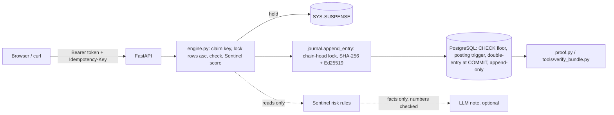

# LedgerLine — money movement with a ledger you can prove

**Live:** `https://<your-service>.onrender.com` ← replace after deploying (docs/DEPLOY.md) · **API docs:** `/docs` · **Demo video:** _link_

LedgerLine moves money between accounts so that:

* **the books always balance**: double entry, with the sum of every balance exactly 0, and no account below its floor. Enforced by PostgreSQL itself, not only by Python.
* **the same request never pays twice**: an Idempotency-Key is claimed in the same transaction as the money movement. Duplicates, even 20 at the same instant, get the first answer byte for byte, and every duplicate is logged.
* **you can prove what happened**: an append-only, hash-chained, **Ed25519-signed** journal of every posting, every refused attempt, every AI suggestion and every human decision. Anyone can verify an export offline with only the public key.

What sets it apart:

* **The database is the backstop.** CHECK constraints and triggers mean even a buggy app cannot overdraw, create money or edit history.
* **Mutation-tested tests.** `tools/mutation_check.py` removes each of 47 locks and checks; the test suite fails every time ([report](docs/MUTATION_REPORT.md)).
* **Red-team script.** `tools/attack.py` runs the judges' attacks against any URL and prints a scorecard.
* **AI that flags, people who decide.** Sentinel holds risky payments in suspense with explained reasons. An optional LLM writes reviewer notes that never see user text and whose every number is checked. A test proves the AI cannot reach money-moving code.
* **Race Lab** in the UI fires real concurrent requests from your browser.

## Demo accounts

| Role | Username | Password | Can |
|---|---|---|---|
| Account holder | `priya` | `LedgerPriya#2026` | own accounts LL-1001 (Salary), LL-1002 (Savings): withdraw, transfer, Race Lab |
| Account holder | `rahul` | `LedgerRahul#2026` | LL-1003, the victim for "move another user's money" |
| Account holder | `acme` | `LedgerAcme#2026` | LL-1004 (a vendor) |
| Administrator | `admin` | `LedgerAdmin#2026` | deposits, open/freeze accounts, overdrafts, users, approve/reject held payments, reversals |
| Auditor (read-only) | `auditor` | `LedgerAudit#2026` | everything read-only: proof, journal, flags, duplicates, evidence export |
| Auditor, **waiting for approval** | `meera` | `LedgerMeera#2026` | nothing yet: signing in says the request is waiting. Approve it as `admin` (Users page), then sign in |

Anyone can also **create a user** from the home page and pick the account type:

* **Account holder**: ready straight away, with one account at ₹0.00.
* **Auditor**: only a *request*. Nobody can sign in with it until an administrator approves it on the Users page, and the approval or decline is a signed journal entry.

Administrator access is never self-service. PostgreSQL enforces this as well: it refuses a request for admin access, a decision not made by an administrator on the record, a second decision, a change of role, and any admin or auditor not created on the record by another administrator.

## Roles and what each may do

| | admin | holder | auditor |
|---|:-:|:-:|:-:|
| See accounts and statements | all | own | all |
| Deposit (money arriving from outside) | ✓ | – | – |
| Withdraw / transfer | – | own accounts only | – |
| Approve / reject held payments | ✓ | – | – |
| Reverse a posted entry (new entry, reason required) | ✓ | – | – |
| Open, freeze, close accounts; set overdraft (≤ ₹50,000); manage users | ✓ | – | – |
| Approve or decline auditor requests from sign-up | ✓ | – | sees them |
| Proof, reconciliation, journal, flags, duplicates, evidence export | ✓ | – | ✓ |

Administrators cannot withdraw from or transfer out of customer accounts. Every role decision is made by the server on every request, and every refused attempt is journaled on the targeted account's statement. Full per-endpoint table: [docs/API.md](docs/API.md).

## Run it

Prerequisites: Python 3.13 and PostgreSQL 16 (or Docker). On Windows, see [docs/WALKTHROUGH.md](docs/WALKTHROUGH.md#run-it-on-windows) for step-by-step PowerShell.

```bash
docker compose up --build                 # app on http://localhost:8000 with demo data
```

or without Docker for the app:

```bash
python -m venv .venv && . .venv/bin/activate      # Windows: .venv\Scripts\Activate.ps1
pip install -r requirements-dev.txt
cp .env.example .env                              # point DATABASE_URL / TEST_DATABASE_URL at your Postgres
python -m app.cli migrate && python -m app.cli seed
uvicorn app.main:app --reload
```

After pulling an update, run `python -m app.cli migrate` again: it upgrades an existing database in place and keeps its history. The server refuses to start on an out-of-date database and tells you to do this.

## Prove it

```bash
python -m pytest                          # 132 tests against real PostgreSQL, ~25 s
python tools/mutation_check.py            # remove each lock/check, prove a test fails (~10 min)
python tools/attack.py --url http://localhost:8000
python -m app.cli verify                  # replay the whole journal: 14 checks
python -m app.cli export evidence.json && python tools/verify_bundle.py evidence.json --public-key <key from /api/public-key>
```

## How it works



One money request is **one transaction**: claim the key, lock the customer rows (ascending id), check status, limit and balance, append the signed entry and its postings, store the response, commit. Details and the interview Q&A: [docs/WALKTHROUGH.md](docs/WALKTHROUGH.md).

## Documents

* [THREATS.md](THREATS.md): 82 threats, each with its defence, test, mutation and status, plus the risks we accepted and why.
* [PROMPTS.md](PROMPTS.md): how AI was used and where it was wrong.
* [docs/WRITEUP.md](docs/WRITEUP.md): what we built, what we did not, our integrity and concurrency model, what is unfinished.
* [docs/API.md](docs/API.md): every endpoint, who may call it, what it does to the money.
* [docs/DEPLOY.md](docs/DEPLOY.md): Render (blueprint included), Docker, Neon.
* [docs/DEMO_SCRIPT.md](docs/DEMO_SCRIPT.md): the five-minute demo.
* [docs/MUTATION_REPORT.md](docs/MUTATION_REPORT.md): which test catches each removed defence.

## Stack

Python 3.13 · FastAPI · PostgreSQL 16 (psycopg 3, raw SQL so the locking is visible) · PyJWT · cryptography (Ed25519) · vanilla JS UI (no build step) · pytest · optional Claude Haiku for reviewer notes.

## Layout

```
app/schema.sql            every money rule PostgreSQL enforces
app/migrations/           schema upgrades on top of it (002: auditor requests, role guards)
app/ledger/engine.py      every rupee moves through here
app/ledger/journal.py     the only writer of journal rows and postings (hash chain + signatures)
app/ledger/idempotency.py exactly-once
app/ledger/proof.py       14-check replay of the whole journal; evidence export
app/sentinel/             risk scoring and LLM notes (cannot import money code)
app/api/                  HTTP routes, auth, validation
static/                   web UI
tests/                    races, retries, crashes, theft, tampering, AI guardrails
tools/                    attack.py, mutation_check.py, verify_bundle.py
```
